# SEGA MODEL 1&2&3 Emulator for Windows

**Sega's 90s arcade boards — Model 1, Model 2 and Model 3 — in one emulator, by uronito (Alberto V).**
Virtua Racing, Daytona USA, Sega Rally, Virtua Fighter 2 and 3, Scud Race, Daytona USA 2, Virtua Cop, The House of the Dead, The Lost World and many more, with a modern launcher, shaders, widescreen, rewind, save states, network play, force feedback, light guns and LED strips.

This repository holds the **Windows releases only** (no source code). [**Download the latest version →**](../../releases/latest)

> ### 📱 Also on Android — on Google Play
> The same emulator for phones, tablets, handhelds (Retroid Pocket, AYN Odin, Anbernic…) and Android TV, with **touch controls laid out for every game**, an on-screen steering wheel, a steering assist made for sticks and touch, pads and more.
>
> **[Get it on Google Play → Sega Model Emulator 1&2&3](https://play.google.com/store/apps/details?id=com.albertov.model)**
>
> 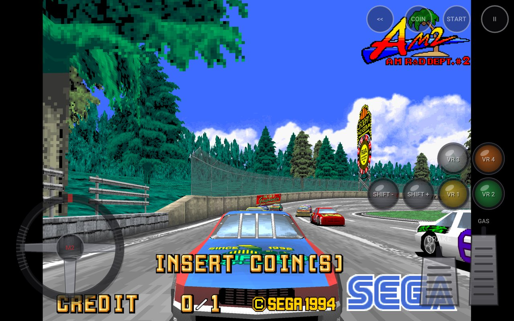
>
> And **Windows and Android play together**: network play works between a PC and a phone, tablet or handheld on the same Wi-Fi. Race your friend's phone from your PC in Daytona USA, or fight off the zombies in The House of the Dead side by side, each on their own device.

*[Leer en español ↓](#español)*

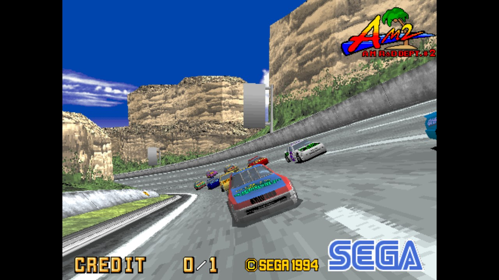

---

## Contents

- [Download and first start](#download-and-first-start)
- [Play across Windows and Android](#play-across-windows-and-android)
- [The systems and games](#the-systems-and-games)
- [The launcher](#the-launcher)
- [Picture: resolution, shaders, upscaling, widescreen](#picture-resolution-shaders-upscaling-widescreen)
- [Controls: keyboard, pads, wheels, light guns](#controls-keyboard-pads-wheels-light-guns)
- [Force feedback and rumble](#force-feedback-and-rumble)
- [LED strips: WLED and Adalight](#led-strips-wled-and-adalight)
- [Linked cabinets and network play](#linked-cabinets-and-network-play)
- [Save states, rewind, cheats](#save-states-rewind-cheats)
- [The pause menu](#the-pause-menu)
- [Performance](#performance)
- [System requirements](#system-requirements)
- [Releases](#releases)
- [FAQ](#faq)
- [License](#license)
- [Español](#español)

---

## Download and first start

1. Download the latest `m2emu-<version>-windows.zip` from [Releases](../../releases/latest).
2. Unzip it anywhere: a folder on your desktop, a USB stick. It is **portable**: nothing is installed, and the settings (`m2emu.ini`), save data, save states and cover art are kept next to `m2emu.exe`.
3. Run `m2emu.exe`. A first-run setup asks for the folder with your games.
4. Choose the folder that holds your ROM zip files (MAME-style sets: `daytona.zip`, `srallyc.zip`, `vf2.zip`, `scud.zip`…). Folders inside it are searched too.
5. Pick a game and press **Play**. **Esc** opens the pause menu.

**No games are included.** Use dumps of the boards you own. The launcher checks each game's ROM files and tells you exactly which are missing.

Windows SmartScreen may warn the first time you run a new download from the internet ("Windows protected your PC"): choose *More info → Run anyway*. When you host a network game the first time, Windows asks whether the emulator may use the network: allow it on private networks.

## Play across Windows and Android

The emulator is the same program on Windows and Android, frame for frame: both run the arcade machine identically, so they can **play together over the network**.

- **Two devices, two cabinets.** In the driving games with a link (Daytona USA, Sega Rally, Scud Race, Daytona USA 2, Sega Rally 2 and the others) each device runs its own cabinet and the two are linked as two machines are by the arcade's cable: player 1 on the PC, player 2 on the phone, each with their own screen and sound.
- **One machine on two devices.** The two-player games without a link — the light gun games (Virtua Cop 1 and 2, The House of the Dead, Gunblade NY, Rail Chase 2, Behind Enemy Lines, The Lost World, Ocean Hunter, L.A. Machineguns) and, on Model 3, Virtua Fighter 3, Fighting Vipers 2, the Virtua Striker 2 family and Magical Truck Adventure — run as one machine on both devices, each player aiming and playing on their own.
- **Simple to set up.** In the launcher, the *Players* button beside a game: one device *hosts* (and shows its address), the other *joins*. Nothing goes through the internet: the devices talk directly on your Wi-Fi.
- Any mix works: PC + PC, phone + phone, **PC + phone, tablet or handheld**.

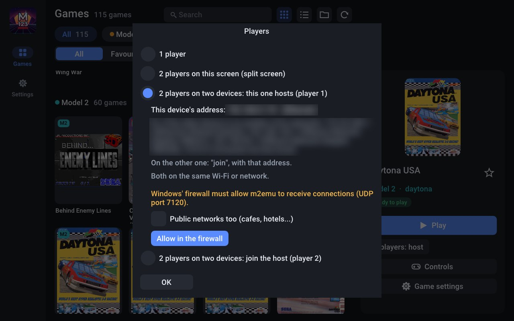

Want your friends in? They can get the Android version on [Google Play](https://play.google.com/store/apps/details?id=com.albertov.model).

## The systems and games

| | Board | Some of its games |
|---|---|---|
| **Model 1** | V60 CPU, TGP geometry processor | Virtua Racing, Virtua Fighter, Star Wars Arcade, Wing War, Virtua Formula |
| **Model 2** | i960 CPU, TGP | Daytona USA (and its '93, Special, Turbo, GTX2004 and To The Maxx editions), Desert Tank, Virtua Cop |
| **Model 2A** | | Sega Rally Championship, Virtua Fighter 2 and 2.1, Virtua Cop 2, Manx TT Superbike, Dead or Alive, Dynamite Cop, Sky Target, Motor Raid, Zero Gunner, Pilot Kids, Air Walkers… |
| **Model 2B** | SHARC geometry processor | Fighting Vipers, Sonic the Fighters, Last Bronx, Cyber Troopers Virtual-On, Indy 500, Gunblade NY, Rail Chase 2, Virtua Striker, Super GT 24h, Power Sled, Dynamite Baseball… |
| **Model 2C** | TGPx4 geometry processor | The House of the Dead, Sega Touring Car Championship, Behind Enemy Lines, Over Rev, Top Skater, Sega Ski Super G, Sega Water Ski, Wave Runner… |
| **Model 3** | PowerPC CPU, Real3D GPU | Scud Race, Daytona USA 2, Sega Rally 2, Virtua Fighter 3, Fighting Vipers 2, Spikeout, Le Mans 24, The Lost World, The Ocean Hunter, L.A. Machineguns, Star Wars Trilogy Arcade, Harley-Davidson & L.A. Riders, Virtua Striker 2, Virtual On 2, Emergency Call Ambulance, Dirt Devils, Ski Champ, Sega Bass Fishing, Magical Truck Adventure… |

The usual MAME-style romsets work as they are, including clones and regional versions. The launcher marks every game: green, known to work; yellow, not tested yet; red, ROM files missing.

## The launcher

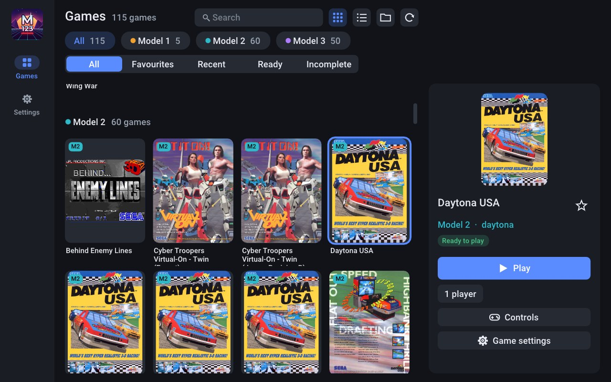

- A **grid of covers** (or a list), with every game's original arcade flyer downloaded automatically the first time it shows (or your own picture).
- **Tabs per system** (Model 1, 2, 3) and **filters**: all, favourites, recent, ready to play, incomplete; a **search** box.
- Each game's **panel**: Play, continue from your last save state (with its picture and time), players and network play, controls, and the game's own settings.
- **Settings for each system, and each game's own over them**: change the shader or the controls for one game only; a badge shows how many settings a game has of its own, and one button puts them all back.
- A **ROM check** that tells you which file is missing or wrong, by name and checksum.
- Works with the **mouse, the keyboard or a pad** (navigate with the d-pad, A to choose, B to go back), and with touch on touch screens.
- **Interface size** from 50% to 200%, **light and dark** looks.
- Six languages: **English, Spanish, Portuguese, French, Italian and German** (following Windows', or chosen).
- Every setting has its **explanation** right under it: no guessing.

## Picture: resolution, shaders, upscaling, widescreen

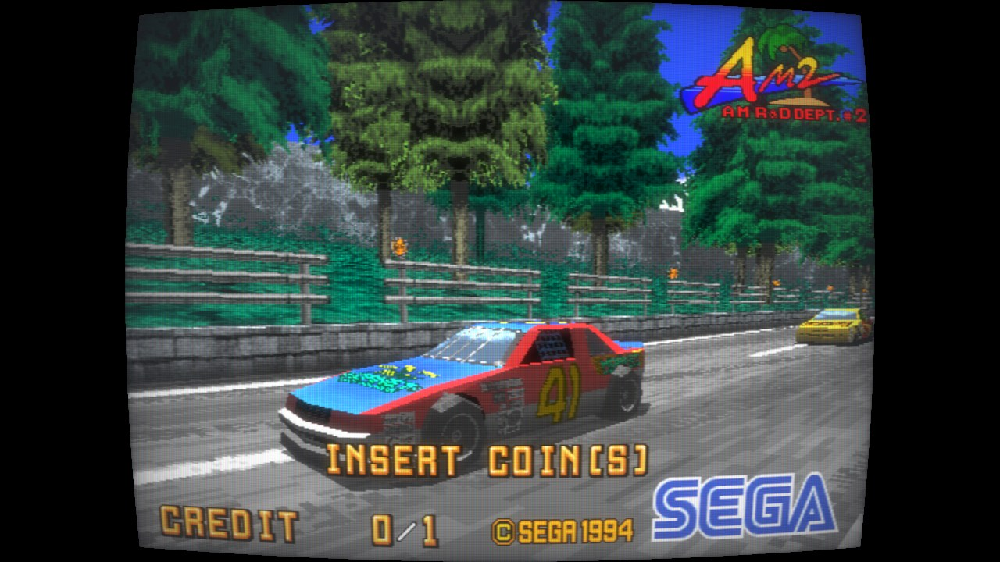

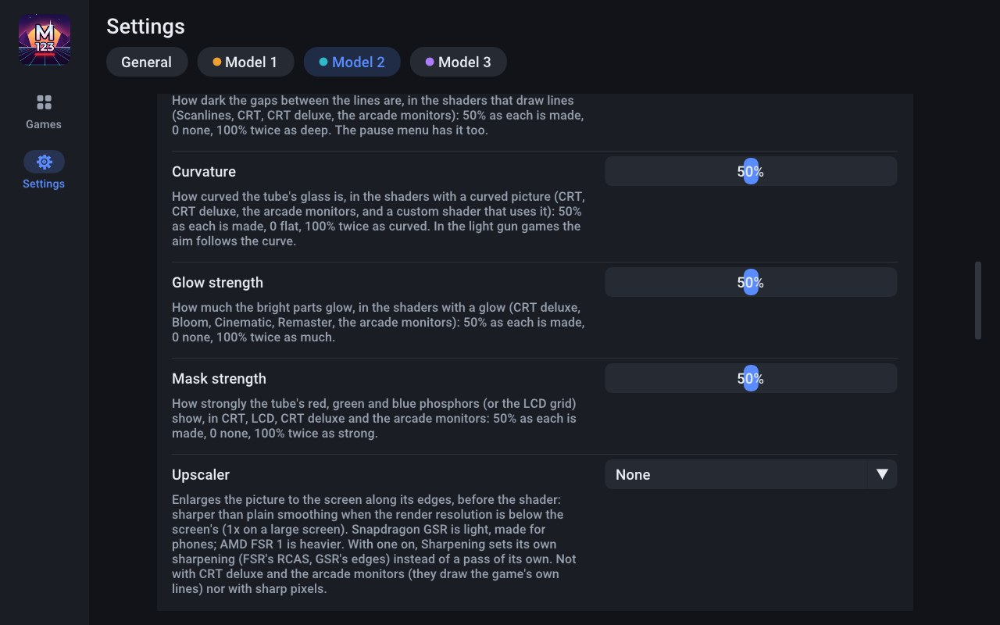

- **Render resolution**: the 3D drawn at a multiple of the original (496 × 384 on Model 2), up to 4K and beyond, or Auto, the largest that fits the window. Below 1x too, for slow GPUs.
- **Multisampling (MSAA)** up to 8x and **FXAA** antialiasing, applied to the 3D before the HUD so the text stays sharp; **texture filtering** nearest, bilinear or trilinear.
- **Model 3 on the GPU**: the Real3D picture drawn by a **Vulkan** renderer on Windows, with quality presets and every optimisation a setting of its own.
- **Shaders**, over the finished picture:
  - `scanlines`, `crt` (a curved tube with an aperture grille), `sharp` (crisp, even pixels at any size), `lcd`;
  - `crt-deluxe`: an arcade monitor up close — curved glass, glowing beams that widen where bright, a halo, the grille, vignette and reflection;
  - `bloom` (bright parts glow), `cinematic` (a film look), `remaster` (a clean, modern, sharpened look);
  - arcade monitor shaders: `arcade`, `arcade-grille`, `arcade-dots`, `curved-crt`;
  - your own GLSL shader, from a file.
  - Scanline strength, curvature, glow and mask are adjustable; light guns follow the curve of the tube.
- **Upscalers**: **AMD FidelityFX Super Resolution 1** (FSR) and **Qualcomm Snapdragon Game Super Resolution** (SGSR) enlarge a lower render resolution along its edges instead of blurring it; **contrast-adaptive sharpening**.
- **Widescreen 16:9** (F9): in the 3D views the game draws the extra field of view on both sides — more world, not stretched — while the 2D text and HUD stay in the middle. Per-game rules decide where it applies (races yes, menus no).
- **Screen shape**: 4:3, stretch, integer scaling, picture scaling and shape also from the pause menu.
- **Colour**: saturation and gamma (per channel).

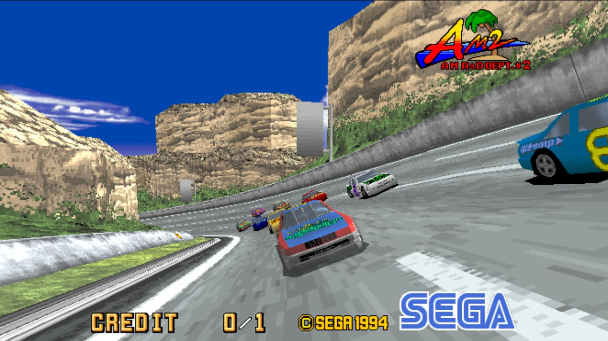

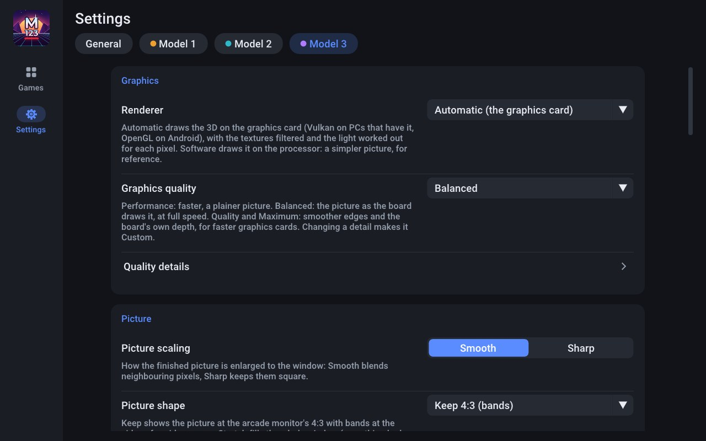

## Controls: keyboard, pads, wheels, light guns

- **Keyboard and any pad** (XInput, DirectInput, PlayStation, Switch Pro…) out of the box, with each game's controls laid out as on its cabinet.
- **Remap** every action per game: choose it and press the key or button.
- **Steering wheels**, with force feedback (below).
- **Steering assist** for sticks and keys: a curve, finer near the centre, and smoothing, so a stick drives like a wheel instead of zig-zagging. A setting for every system and every game, also in the pause menu. Off for a real wheel.
- **Gears**: the cabinets' 4-speed H-pattern on keys or buttons, or sequential up/down shifting, and holding a gear like the real stick.
- **Light guns**:
  - the **mouse** aims and shoots (left fires, right reloads), with a crosshair;
  - a pad's **stick** moves a crosshair;
  - **two light guns or two mice, each its own player's aim**;
  - **GUN4IR** light guns: the gun's **solenoid kicks** with every shot the game fires, and it **rumbles** when you are hit;
  - the crosshair follows the curve of the CRT shaders.
- The **mouse pointer** hides itself while you play.

## Force feedback and rumble

The driving games' **drive board** — the motor in the cabinet's wheel — is emulated: the game tells it what to do and the emulator plays it on your wheel. Centring spring, the push off-centre, resistance and the pull to one side, as strong as the game asks times your **strength setting (0–200%)**. Pads without force feedback **rumble** with the pulls. In the light gun games your pad (or your phone, on Android) shakes when you are hit, and optionally with each shot (**recoil**).

## LED strips: WLED and Adalight

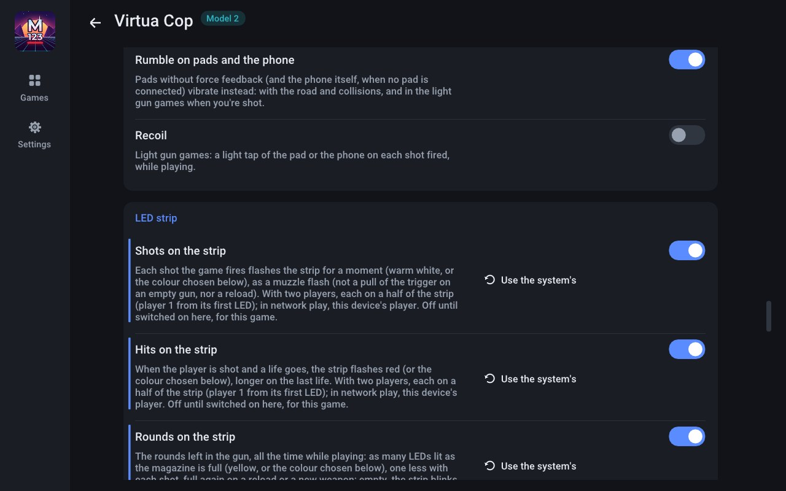

Plug an LED strip (an ESP32 running **WLED** over the network, or any **Adalight** board over USB) and the games drive it:

- **Rev lights** in the driving games: the strip fills green, yellow and red with the engine's revs, read from the game itself, and flashes at the shift point.
- **Light gun games**: a **muzzle flash** with every shot the game fires, **red** when a player is hit (longer on the last life), and the **rounds left in your gun** as a bar that blinks when it's empty — RELOAD! With two players, each on half the strip.
- **Colours per game**, with a Test button that shows it on the strip at once; brightness also in the pause menu.

## Linked cabinets and network play

- **Two players, linked, on one PC**: two complete machines in one window, split side by side or one above the other, linked through their network boards as two cabinets in the arcade. Player 1 on the keyboard and pad 1, player 2 on pad 2.
- **Network play on two devices**, Windows and Android in any mix (see [above](#play-across-windows-and-android)).
- The emulator handles the **Windows firewall** for you when hosting, and shows this PC's addresses to give to the other player.

## Save states, rewind, cheats

- **Save states**: 8 slots per game, each **with a picture** and the time it was saved, in the pause menu and on the game's panel in the launcher ("Continue from slot"). Shift+F2 saves, Shift+F4 loads.
- **Rewind**: hold Backspace (or the pad's left stick button) and the game goes back in time; let go and play on from there. A few minutes of history.
- **Cheats**: the common XML cheat format, switched on and off from the pause menu.
- **Save data** (high scores, the operator's settings) kept per game, as the cabinet's backup memory.

## The pause menu

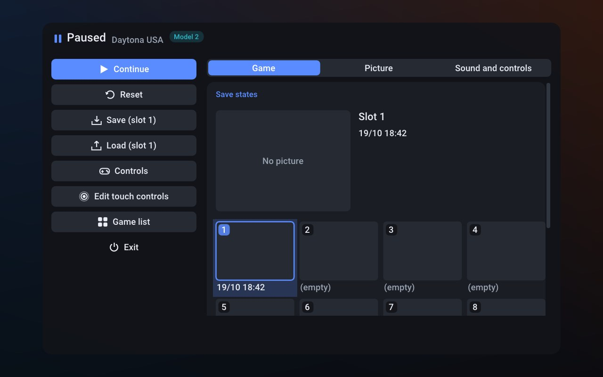

Esc (or a pad's menu button) opens a menu over the game with almost everything at hand, live: save and load states, the shader and its strengths, upscaler, resolution, antialiasing, picture shape and scaling, the steering assist, force feedback strength, LED strip brightness, cheats, controls, reset. Changes can be kept as **this game's own settings** with one tap.

## Performance

The emulator spreads each frame over several threads (the board, the geometry, the picture, the sound), and Model 3's CPU runs on a recompiler. Model 1 and 2 run at full speed on most PCs; Model 3 wants a reasonable CPU and a GPU with Vulkan. Vsync, frame pacing and a frame cap are settings; Model 1 and 3 can run at 60 Hz (smooth on 60 Hz screens) or the boards' exact 57.5 Hz.

## System requirements

- **Windows 10 or 11, 64-bit.**
- A GPU with **OpenGL 3** or later (Model 1 and 2); **Vulkan** recommended for Model 3.
- Your own ROM sets.

## Releases

Each release is a zip with:

| File | What it is |
|---|---|
| `m2emu.exe` | the emulator (launcher and games) |
| `SDL2.dll`, `zlib1.dll`, `libwinpthread-1.dll` | the libraries it needs |
| `README.txt` | quick start |
| `LICENSE.txt` | the license |
| `NOTICE.txt` | the third-party components' notices |

To update, unzip the new version over the old folder (your `m2emu.ini`, saves and states stay). Save states belong to the version that made them: a newer one may not load an older one's states, the game simply goes on.

See every version and what changed on the [Releases page](../../releases).

## FAQ

**Where do I get the games?** They are not included and not shared here. Use dumps of boards you own.

**Is it a RetroArch core?** No: a standalone emulator with its own launcher, for Windows and Android.

**Is there a version for my phone?** Yes, for Android: [Google Play](https://play.google.com/store/apps/details?id=com.albertov.model). With touch controls for every game, an on-screen wheel, the steering assist, pads, handhelds and Android TV — and it plays online with the Windows version.

**iPhone / Mac / Linux?** Not for now.

**A game doesn't work.** Open an [issue](../../issues) with the game, your PC (CPU, GPU) and what happens; it helps the next version.

**My antivirus or SmartScreen complains.** New downloads without a long reputation get that warning. The zip comes only from this page.

## License

The emulator is © 2026 uronito (Alberto V), all rights reserved. You may download it from this page and use it for your own personal, non-commercial use; see `LICENSE.txt` in the zip. It includes third-party components under their own licenses (`NOTICE.txt`). It doesn't include any game, and no right over the games or their ROMs is granted or claimed. *Sega*, *Model 1*, *Model 2*, *Model 3* and the games' names are trademarks of their owners, used here only to say which hardware and games the emulator runs; this project is not affiliated with or endorsed by Sega.

---

## Español

**Las placas recreativas de Sega de los 90 — Model 1, Model 2 y Model 3 — en un solo emulador, por uronito (Alberto V).**
Virtua Racing, Daytona USA, Sega Rally, Virtua Fighter 2 y 3, Scud Race, Daytona USA 2, Virtua Cop, The House of the Dead, The Lost World y muchos más, con un lanzador moderno, shaders, pantalla panorámica, rebobinado, partidas guardadas, juego en red, force feedback, pistolas de luz y tiras de LEDs.

Este repositorio contiene **solo las versiones para Windows** (sin código fuente). [**Descarga la última versión →**](../../releases/latest)

> ### 📱 También para Android — en Google Play
> El mismo emulador para móviles, tablets, consolas portátiles (Retroid Pocket, AYN Odin, Anbernic…) y Android TV, con **controles táctiles diseñados para cada juego**, volante en pantalla, asistencia de dirección pensada para sticks y pantalla táctil, mandos y mucho más.
>
> **[Consíguelo en Google Play → Sega Model Emulator 1&2&3](https://play.google.com/store/apps/details?id=com.albertov.model)**
>
> Y **Windows y Android juegan juntos**: el juego en red funciona entre un PC y un móvil, tablet o portátil en la misma wifi. Échale una carrera desde tu PC al móvil de tu amigo en Daytona USA, o acabad juntos con los zombis de The House of the Dead, cada uno en su aparato.

### Descarga y primer arranque

1. Descarga el último `m2emu-<versión>-windows.zip` de [Releases](../../releases/latest).
2. Descomprímelo donde quieras. Es **portable**: no se instala nada, y los ajustes, partidas guardadas, estados y carátulas se guardan junto a `m2emu.exe`.
3. Abre `m2emu.exe`; la primera vez te pide la carpeta de tus juegos.
4. Elige la carpeta con tus ROMs en .zip (sets como los de MAME: `daytona.zip`, `srallyc.zip`, `vf2.zip`, `scud.zip`…); también busca en sus subcarpetas.
5. Elige un juego y pulsa **Jugar**. **Esc** abre el menú de pausa.

**No incluye juegos**: usa copias de placas que tengas. El lanzador comprueba los ficheros de cada juego y te dice exactamente cuál falta. Si SmartScreen avisa la primera vez ("Windows protegió tu PC"), pulsa *Más información → Ejecutar de todas formas*.

### Juego cruzado entre Windows y Android

El emulador es el mismo programa en Windows y en Android, fotograma a fotograma: los dos ejecutan la máquina igual, así que **juegan juntos por red**.

- **Dos aparatos, dos máquinas enlazadas** en los juegos de conducción con enlace (Daytona USA, Sega Rally, Scud Race, Daytona USA 2, Sega Rally 2 y los demás): el jugador 1 en el PC, el 2 en el móvil, cada uno con su pantalla y su sonido.
- **Una máquina en dos aparatos** en los juegos de dos jugadores sin enlace: los de pistola (Virtua Cop 1 y 2, The House of the Dead, Gunblade NY, Rail Chase 2, Behind Enemy Lines, The Lost World, Ocean Hunter, L.A. Machineguns) y, en Model 3, Virtua Fighter 3, Fighting Vipers 2, Virtua Striker 2 y Magical Truck Adventure.
- **Fácil**: en el lanzador, el botón *Jugadores* junto al juego; un aparato *hospeda* (y muestra su dirección) y el otro *se une*. Nada pasa por internet: se hablan directamente por tu wifi.
- Cualquier combinación: PC + PC, móvil + móvil, **PC + móvil, tablet o portátil**. ¿Tus amigos tienen Android? Pueden conseguirlo en [Google Play](https://play.google.com/store/apps/details?id=com.albertov.model).

### Todo lo que trae

- **Tres sistemas**: Model 1, Model 2 (2A, 2B y 2C) y Model 3, con sus juegos y versiones (ver la tabla de arriba). El lanzador marca cada juego: verde funciona, amarillo sin probar, rojo faltan ficheros.
- **Lanzador**: cuadrícula de carátulas (los flyers originales, descargados solos), pestañas por sistema, favoritos, recientes, búsqueda, panel de cada juego con "continuar desde la ranura", comprobación de ROMs, ajustes por sistema y **ajustes propios de cada juego**, ratón, teclado, mando o pantalla táctil, tamaño de interfaz, tema claro y oscuro, **seis idiomas** y una explicación debajo de cada opción.
- **Imagen**: resolución hasta 4K y más (o por debajo de 1x para GPUs modestas), multimuestreo hasta 8x y FXAA, filtrado de texturas, **Model 3 por GPU con Vulkan**, **shaders** (scanlines, CRT, CRT Deluxe, bloom, cine, remaster, monitores arcade, los tuyos en GLSL), **escaladores FSR 1 y SGSR**, nitidez adaptativa, **panorámico 16:9 real** (más campo de visión, no estirado), forma de pantalla y escalado entero, saturación y gamma.
- **Controles**: teclado y cualquier mando, reasignación por juego, **volantes**, **asistencia de dirección** para sticks y teclas, cambio en H o secuencial, **pistolas de luz** con ratón, stick, **dos pistolas o dos ratones cada uno con su mira** y **GUN4IR** con solenoide y vibración.
- **Force feedback**: el motor del volante de la máquina emulado (centrado, empujes, resistencia, tirones) en tu volante, con fuerza ajustable 0–200%; vibración en mandos sin force feedback; vibración al recibir disparos y retroceso en los juegos de pistola.
- **Tiras de LEDs** (WLED por red o Adalight por USB): **cuentarrevoluciones** en los juegos de coches, **fogonazo de cada disparo**, **rojo al recibir un impacto** y la **barra de balas que te quedan** (parpadea al quedarte sin balas) en los de pistola; colores por juego y botón Probar.
- **Dos jugadores enlazados en un PC** (pantalla partida) y **juego en red** entre dos aparatos, Windows y Android mezclados; el emulador abre él solo el cortafuegos de Windows al hospedar.
- **Estados guardados** (8 ranuras por juego, con imagen y hora), **rebobinado** manteniendo un botón, **trucos** en XML y las partidas guardadas de cada máquina.
- **Menú de pausa** con casi todo en directo: estados, shader, escalador, resolución, antialiasing, forma de imagen, asistencia de dirección, fuerza del force feedback, brillo de la tira, trucos, controles, reset, y guardar cambios como ajustes propios del juego.
- **Rendimiento**: cada fotograma repartido en varios hilos y la CPU de Model 3 recompilada. Model 1 y 2 van a velocidad completa en la mayoría de PCs; Model 3 pide una CPU razonable y una GPU con Vulkan.

### Requisitos

Windows 10 u 11 de 64 bits; GPU con OpenGL 3 o superior (Model 1 y 2) y Vulkan recomendado para Model 3; tus propias ROMs.

### Versiones

Cada versión es un zip con `m2emu.exe`, sus librerías (`SDL2.dll`, `zlib1.dll`, `libwinpthread-1.dll`), `README.txt`, `LICENSE.txt` y `NOTICE.txt`. Para actualizar, descomprime la nueva encima de la anterior: tus ajustes, partidas y estados se conservan. Todas las versiones y sus cambios, en [Releases](../../releases).

### Preguntas frecuentes

- **¿Dónde consigo los juegos?** No se incluyen ni se comparten aquí. Usa copias de placas que tengas.
- **¿Es un núcleo de RetroArch?** No: es un emulador independiente con su propio lanzador, para Windows y Android.
- **¿Hay versión para el móvil?** Sí, para Android: [Google Play](https://play.google.com/store/apps/details?id=com.albertov.model), con controles táctiles por juego, volante en pantalla, asistencia de dirección, mandos, portátiles y Android TV, y juega en red con la versión de Windows.
- **¿iPhone, Mac, Linux?** De momento no.
- **Un juego va mal.** Abre un [issue](../../issues) con el juego, tu PC (CPU y gráfica) y qué pasa.

### Licencia

El emulador es © 2026 uronito (Alberto V), todos los derechos reservados. Puedes descargarlo de esta página y usarlo para tu uso personal y no comercial; ver `LICENSE.txt` en el zip. Incluye componentes de terceros con sus propias licencias (`NOTICE.txt`). No incluye ningún juego ni concede ni reclama derechos sobre los juegos o sus ROMs. *Sega*, *Model 1*, *Model 2*, *Model 3* y los nombres de los juegos son marcas de sus dueños, usadas solo para indicar qué hardware y juegos emula; este proyecto no está afiliado a Sega ni respaldado por ella.

---

## Gallery · Galería

  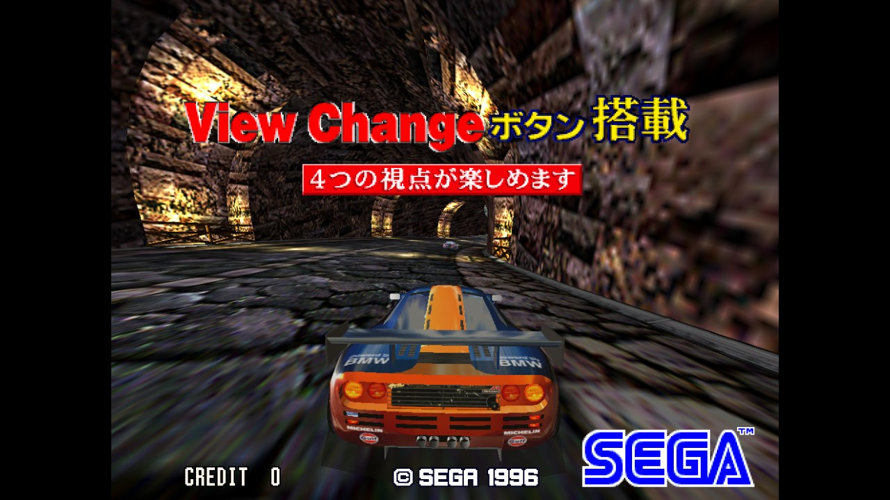
  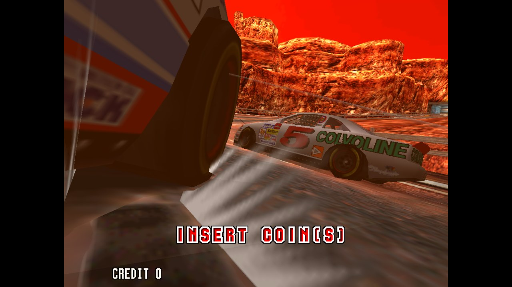
  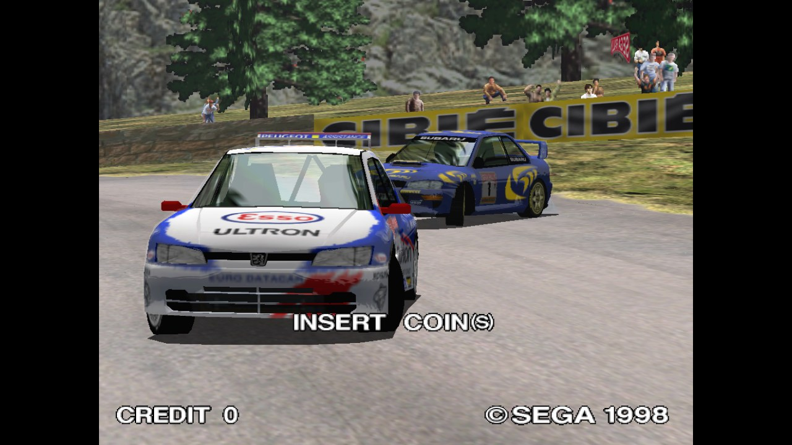
  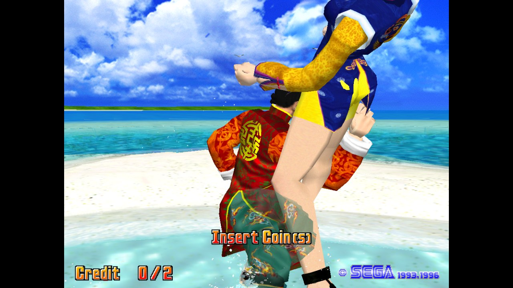
  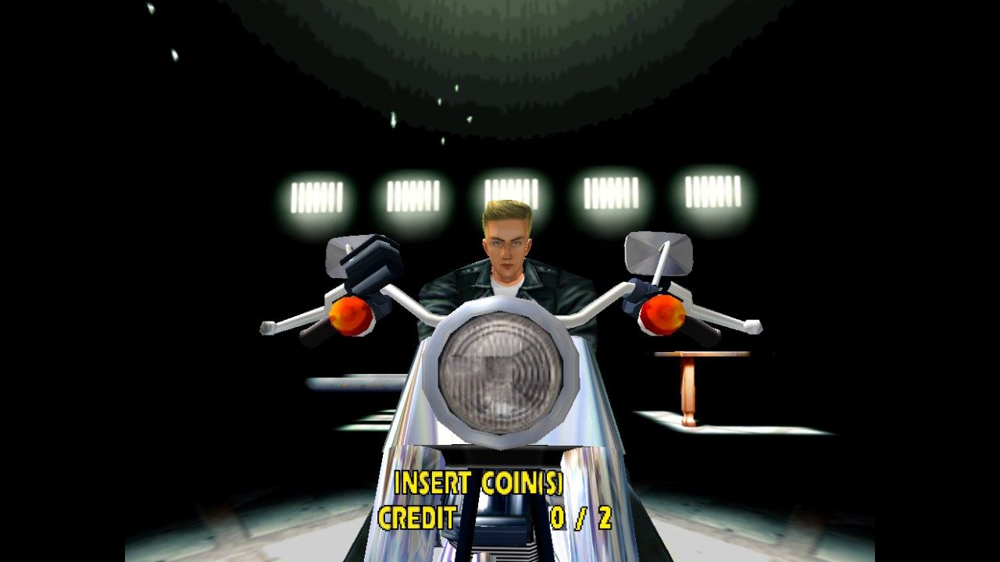
  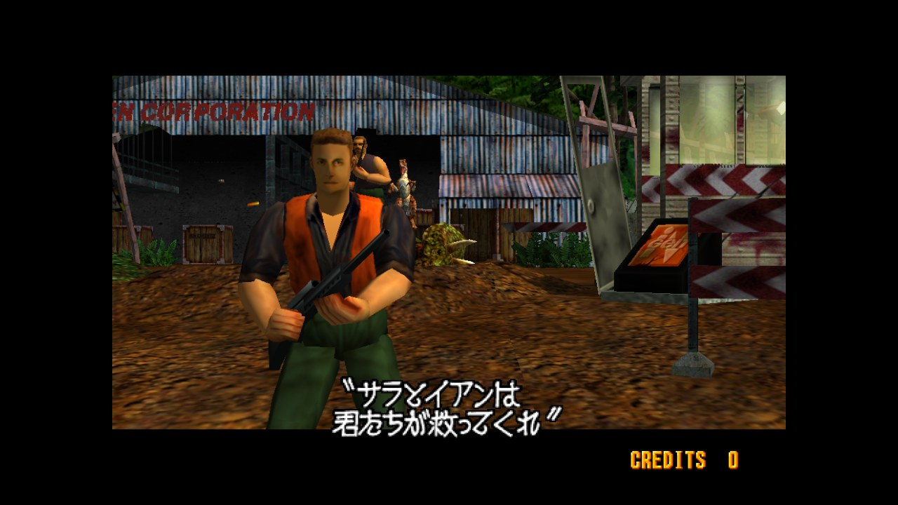
  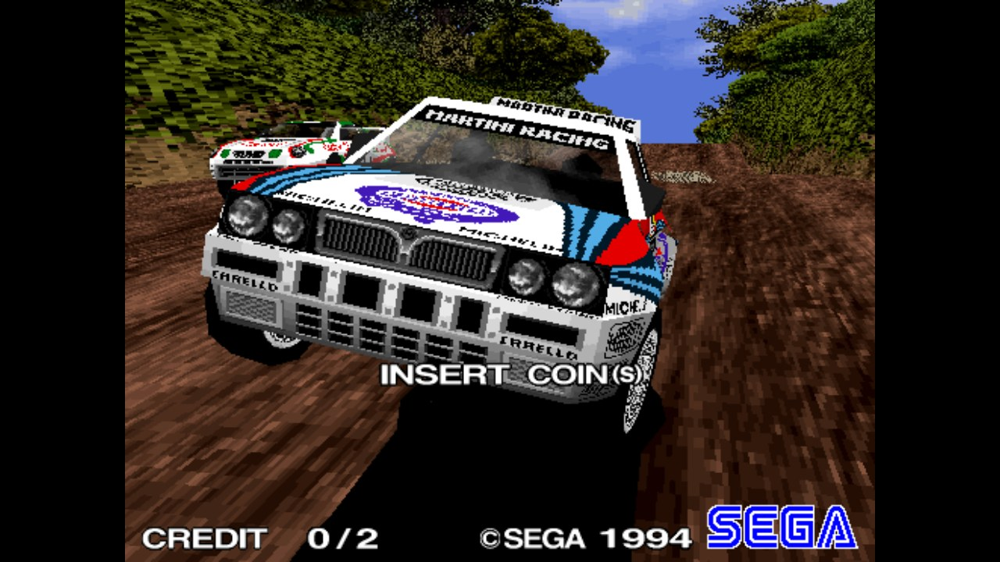
  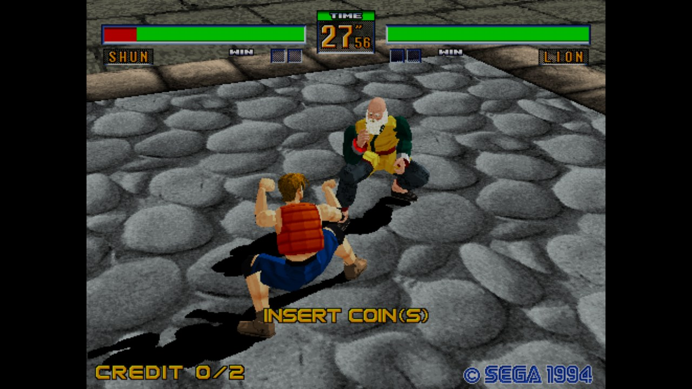
  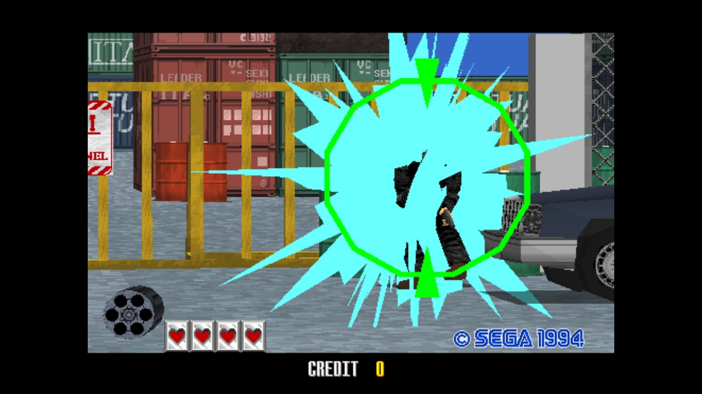
  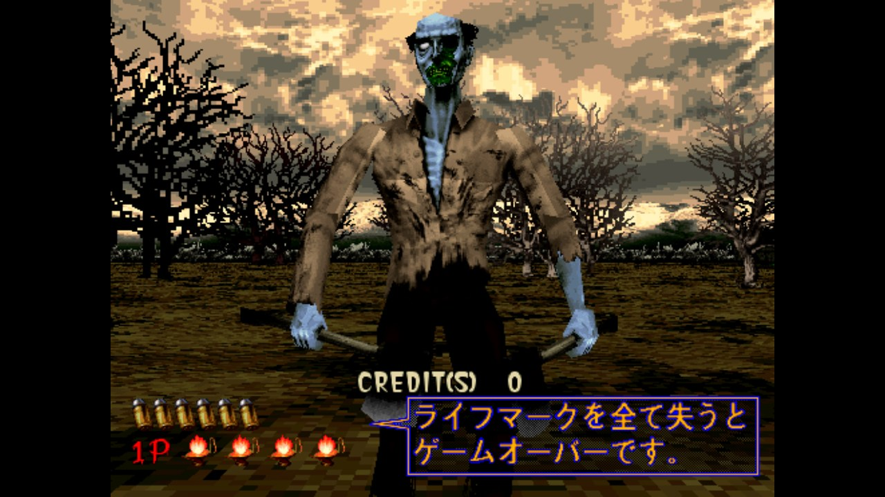
  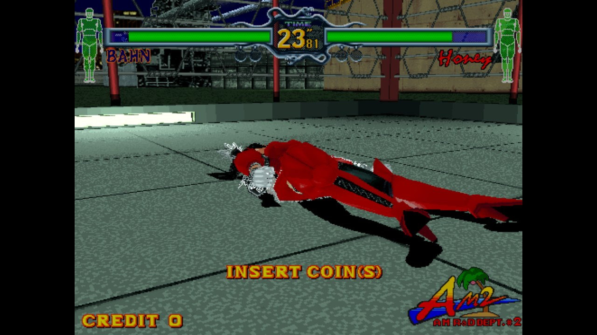
  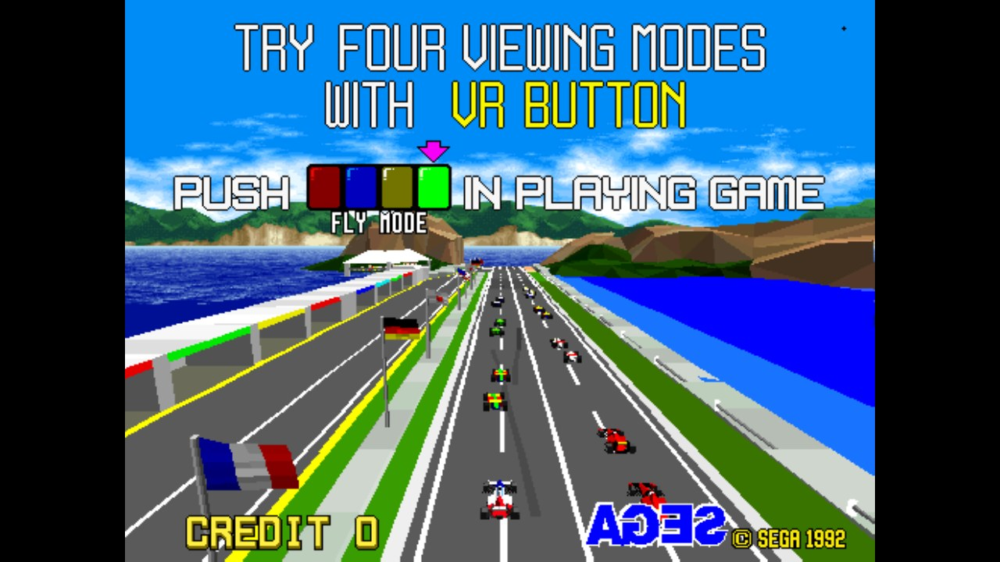

<i>Screenshots of this Windows version, taken from the emulator at 1280 × 720 · Capturas de esta versión de Windows a 1280 × 720</i>

